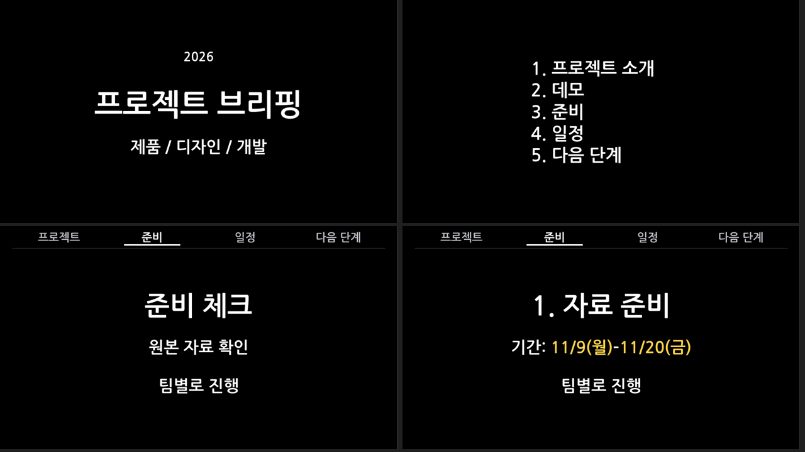

# Blackstage PPTX

An editable PowerPoint generator and agent skill for black backgrounds, large bold type, and short, presentation-ready copy. The included demo uses a generic project briefing, with no private content or assets.

Text, arrows, and navigation labels remain native, editable PowerPoint objects. A roadmap label can move and shrink into the top navigation on the same slide, followed by a content or photo reveal.



## Quick start

Requires Node.js 20+ and Python 3.10+. The Python scripts use only the standard library.

```bash
git clone https://github.com/nathankim0/blackstage-pptx.git
cd blackstage-pptx
npm ci
npm test
npm run example
```

The default typeface is [Nanum Gothic](https://fonts.google.com/specimen/Nanum+Gothic) Bold. Install it on both the authoring and presentation computers, or set `font` in your JSON to an installed font with the glyphs you need. Fonts are not embedded in the PPTX.

For PDF output, install [LibreOffice](https://www.libreoffice.org/download/download-libreoffice/) and use a new output filename:

```bash
node scripts/build.mjs examples/demo.json output/demo-v2.pptx --pdf
python3 scripts/pptx.py check output/demo-v2.pptx
```

Set `PYTHON` to select a Python executable. Relative image paths resolve from the input JSON file, not the current working directory.

When available, `fc-match` locates the requested fonts for PDF conversion. Copies are placed in a temporary LibreOffice profile to avoid missing Korean glyphs in macOS headless conversion. System fonts and the user's LibreOffice profile are left unchanged. To supply fonts directly, set `BLACKSTAGE_FONT_DIR` to a directory containing the TTF, OTF, or TTC files. On macOS, conversion stops if no usable font files can be found.

```bash
BLACKSTAGE_FONT_DIR=/path/to/fonts node scripts/build.mjs examples/demo.json output/demo-v3.pptx --pdf
```

Generated files:

- `demo-v2.pptx`: the editable, click-driven presentation.
- `demo-v2.static.pptx`: the same logical slides at their completed animation states.
- `demo-v2.checks.json`: motion geometry, package checks, and file hashes. `powerpoint_playback_verified` defaults to `false`.
- `demo-v2.pdf`: a static handout, generated only with `--pdf`.

Existing outputs are never overwritten. If an output already exists or conversion fails, the new output set is not published. Temporary build directories are cleaned up. Use trusted local JSON and images as inputs. This is a JSON-based generator, not an import/export editor for arbitrary existing PPTX files.

## Input format

Start with [examples/demo.json](examples/demo.json). `sections` defines the top navigation, using stable `id` values and display `label` values. `toc.items` is a separate agenda list and does not need to match the navigation.

| Kind | Fields | Purpose |
| --- | --- | --- |
| `cover` | `title`; optional `kicker`, `subtitle` | Title slide without navigation |
| `toc` | 1-6 `items` | A centered group of left-aligned agenda entries |
| `title` | `title` | A single title, such as a separately played video cue |
| `text` | `title`, up to 2 `lines` | Consistently positioned title and body copy |
| `image` | `path`; optional `alt` | A poster or photo, contained without cropping |
| `gallery` | Optional `title`; 1-4 `images` | A 2x2 photo grid with large labels and borders |
| `roadmap` | 3 `steps`, `focus`, `section`, `reveal` | Move the original label into the navigation, then reveal content |

Common optional fields are `notes`, `section`, and `nav:false`. Cover and agenda slides hide the navigation automatically. A roadmap requires a visible navigation destination, so it does not accept `nav:false`. Top navigation supports up to four sections.

```json
{"kind":"text","section":"prepare","title":"1. Prepare materials",
 "lines":[[{"text":"Dates: "},{"date":"2026-11-09"},{"text":"–"},{"date":"2026-11-20"}],"Work in groups"]}
```

`date` fields calculate the weekday from the ISO date and render it in yellow. Weekday labels currently use Korean. Labels and times remain white; keep them as separate `text` runs.

```json
{"kind":"gallery","section":"prepare","title":"Preparation log",
 "images":[{"path":"images/day-1.jpg","label":"Day 1","alt":"First day of preparation"},
           {"path":"images/day-2.jpg","label":"Day 2","alt":"Second day of preparation"}]}
```

Images retain their original aspect ratios without cropping. Overlong text raises an error instead of shrinking silently. Width checks are conservative estimates, not a substitute for rendering with the actual font. Split long content across slides.

## Roadmap-to-navigation animation

The animation is included in the generated presentation, not just described in the skill:

1. The roadmap's original label is visible before the click.
2. One click moves and shrinks that same text object into the top navigation over 1.2 seconds.
3. Content or photos appear on the same slide after the label arrives. The reveal finishes at 1.45 seconds.
4. The next click advances to the next logical slide, without a duplicate static slide in between.

The PPTX contains native PresentationML `animMotion` and `animScale` behaviors targeting the same existing shape. Its destination is calculated from the actual object centers, not hard-coded slide numbers or shape IDs. Changing section order or inserting slides rebuilds the target geometry.

For example, this complete input moves the original **Prepare** label into the matching navigation section:

```json
{
  "title": "Project briefing",
  "sections": [{"id": "prepare", "label": "Prepare"}],
  "slides": [{
    "kind": "roadmap", "section": "prepare", "focus": 1,
    "steps": [{"label": "Plan"}, {"label": "Prepare"}, {"label": "Launch"}],
    "reveal": {"kind": "text", "title": "Preparation checklist", "lines": ["Check source materials", "Work in groups"]}
  }]
}
```

The focus label must exactly match its destination section label. `focus` is a zero-based step index. `reveal` accepts `text` or `gallery` content. Use the playable `.pptx` for animations; `.static.pptx`, PDF, and the preview image intentionally show only the completed state.

Tests verify the same shape is used for both motion and scale, that the current slide waits for a click, and that geometry survives navigation reordering and slide insertion or removal. They do not run Microsoft PowerPoint or prove its playback behavior.

## Install the agent skill

The whole repository is a skill directory. Link the entire checkout; copying only `SKILL.md` omits the scripts. Run these commands from the repository root only if a skill with this name does not already exist:

```bash
mkdir -p ~/.codex/skills
ln -s "$PWD" ~/.codex/skills/blackstage-pptx
# For Claude Code, link the same checkout
mkdir -p ~/.claude/skills
ln -s "$PWD" ~/.claude/skills/blackstage-pptx
```

In a new session, invoke `$blackstage-pptx` or ask for a black-background presentation with large bold text. See [SKILL.md](SKILL.md) for authoring instructions and [references/continuous-motion.md](references/continuous-motion.md) for implementation notes and regression checks. These agent-facing documents and the bundled demo currently use Korean.

## Verification and limitations

- Tests cover same-object motion and scaling, actual center coordinates, navigation and slide reordering, image aspect ratios, dates, static end states, file preservation, and ZIP relationships. When LibreOffice and Poppler are available, they also check PDF page counts and actual Nanum font inclusion; otherwise, only the PDF test is skipped.
- PDF output uses a separate completed-state deck. No duplicate static slides are inserted into the playable deck.
- LibreOffice rendering, PDF inspection, and package checks do not prove Microsoft PowerPoint slideshow playback. Check the original label, first-click movement and reveal, and next-click slide advance on the presentation computer. Actual PowerPoint playback has not been verified.
- PDF conversion uses a temporary LibreOffice profile and does not operate on the user's open LibreOffice documents.
- There is one built-in 16:9 theme. A web editor, embedded video, and arbitrary PPTX conversion are outside the scope of this project.

## License

[MIT](LICENSE). PptxGenJS, fonts, and images retain their own licenses. This repository does not redistribute user photos or font files.
